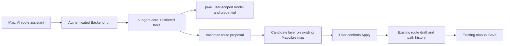

# Route Assistant Drafts

Status: Proposed. This plan authorizes no implementation, paid inference, database operation, or device action.

## Goal

Let a user describe a route change in the existing Map editor, review a candidate path, and explicitly apply it to the current draft. Keep manual Save and existing Undo/Redo, Share, and device playback workflows.

## Dependencies and Context

- Depends on [Personal AI provider settings](2026-10-22_personal-ai-provider-settings-plan.md) for approved providers, account-backed model/thinking settings, and isolated credential access. Fixtures may support development, but shared credentials are not a substitute for that dependency.
- `web/app/dashboard/map/page.tsx` owns the current draft, selection, save lifecycle, and navigation protection. `RouteEditor.tsx` exposes View / Edit / Playback.
- `routeDraftState.ts` provides `replaceRoutePath` and path-only Undo/Redo. One accepted proposal must create one path-history step.
- `RouteMapEditor.tsx` renders direct waypoint segments. Saved routes require 2–1000 ordered points; reducers can hold invalid intermediate drafts, so generated proposals need their own validation.
- Current desktop CSS uses approximately 260px for the picker and 350px for the inspector. The map already excludes those panels; adding a fourth pane would reduce usable map space.
- Road-following paths and place-name search belong to [Road route planning](2026-10-22_road-route-planning-plan.md), not this stage.

## Architecture

### UI and state ownership

- Add one AI route assistant entry beside the existing Edit path tools. Reveal the composer, status, and proposal inside the current inspector; do not create another workspace, map, New route action, or Save button.
- Show the current provider/model/thinking and a guarded settings link. A missing connection opens setup only after the user chooses to leave; it must not discard the draft.
- Keep one inspector scroll owner. Use Radix components and the current message catalogs. Do not add a generic chat UI library or require a new mode switch before ordinary editing.
- The first release modifies path geometry only. Keep name, description, visibility, playback mode, and speed under their current controls because existing Undo is path-only.
- Store proposal/conversation state only for the active editor session, with explicit memory, message, point-count, and output limits. Reload/restart does not promise chat recovery or offline draft persistence.

### Agent and transport boundary

- Run `pi-agent-core` and `pi-ai` in Backend. No coding-agent session, shell, filesystem, arbitrary HTTP, dynamic code, or generic remote-control tools.
- Supply an explicit current-draft snapshot and only user-selected Places owned by the user. Use bounded tools for draft inspection, selected-Place lookup, deterministic path transforms, and proposal submission.
- Generate path operations from known point/Place references or explicit user coordinates. Reverse, insert, remove, reorder, and close-loop operations use deterministic code. Do not invent coordinates for unknown place names.
- Treat prompts, Place text, model messages, and tool arguments as untrusted input. Validate ownership and tool schemas in Backend; the model cannot authorize a write.
- Stream safe text, tool-status labels, validated proposals, and completion/errors through an authenticated fetch stream. Do not expose raw thinking, provider credentials, tool argument dumps, or raw provider errors.
- Verify streaming and abort propagation through `web/app/api/backend/[...path]/route.ts` and the deployed proxy path. Native EventSource must not require credentials in a URL.

### Proposal and lifecycle contract

- Bind each proposal to user/session, editor instance, route identity, a monotonically increasing draft generation, run ID, and settings/connection generation. New-route identity must be distinct from a saved route ID.
- Use a draft-generation counter, not only coordinate equality, so edit → undo cannot make an obsolete proposal current again.
- Validate the complete proposal before preview and Apply: 2–1000 finite in-range coordinates, ordered points, bounded content, and supported operations. Preserve draft IDs and speed/pause metadata for retained points; new points use existing null defaults.
- Streamed partial JSON never changes the draft or becomes an applicable proposal. A completed valid candidate uses a separate source/layer on the existing MapLibre instance.
- Apply once through a functional draft update and `replaceRoutePath`; a second click is a no-op. Preserve all non-path fields, clear the consumed proposal, and issue the existing explicit fit request.
- Manual edits, route changes, discard, settings/credential changes, logout, timeout, and cancellation invalidate affected results. Stale results cannot be applied; offer regeneration without silent rebase.
- Bound run duration, turns, tokens, tools, and per-user concurrency. Propagate cancellation to provider calls and tools; late events are ignored after invalidation.
- Assign a client run ID and reject duplicate active submissions. Do not automatically replay a paid request after disconnect, restart, or an ambiguous failure, and do not claim exactly-once provider billing.

## Non-Goals

- No road routing, geocoding, arbitrary web search, GPX/KML, route recording, automatic Save, or database writes by the agent.
- No agent-triggered Android command, persistent chat history, resumable background job system, or cross-tab route-write concurrency redesign.
- No display of fabricated distance, provider cost, or successful completion when a tool failed. Reported usage may be unavailable for subscription flows.

## Plan

- [ ] Confirm stage 1's provider/credential contracts and verify compatible `pi-agent-core` loading under Node.js 22; record tested package versions and one fake-provider tool loop without a paid call.
- [ ] Define typed run/event/proposal contracts and finite resource limits; add pure tests for malformed input, unsupported operations, unknown Place IDs, point-count/range limits, and retained waypoint metadata.
- [ ] Implement user-scoped restricted tools and deterministic transforms; prove the same operation yields the same ordered path and that user B cannot resolve user A's Places or run/proposal.
- [ ] Implement authenticated bounded run creation, event streaming, and explicit cancellation. Verify ownership on every control path, duplicate start handling, rate limits, abort through the Next.js proxy, provider timeout, malformed output, and no automatic paid retry.
- [ ] Add testable editor generation/proposal state. Cover manual edit, edit → undo, route switch, new-route replacement, discard, save/rebase, settings change, disconnect, logout, late completion, and interleaved runs.
- [ ] Build the disclosed assistant UI in RouteEditor with input, current AI configuration, safe progress, Stop, failure recovery, and proposal summary. Retain keyboard focus, existing Edit tools, one scroll owner, and manual Save semantics.
- [ ] Add the candidate MapLibre layer and clear it on invalidation or discard; verify ready/loading/error maps, distinct current/candidate labels, explicit route fitting, and cleanup without a second map instance.
- [ ] Apply a valid proposal as one path-history entry; test single Apply, repeated clicks, Undo/Redo, retained metadata, unchanged non-path fields, and no route API or device command before the user invokes existing actions.
- [ ] Preserve save lifecycle safety: disable Apply during an in-flight Save and invalidate pending proposals when Save changes the baseline. Failed Save must retain the user's draft; do not describe existing revision snapshots as cross-tab compare-and-swap protection.
- [ ] Add all locale messages and update `docs/web-cloud-guide.md` with account setup, straight-segment limits, provider data disclosure, manual Apply/Save, Stop, transient history, and failure behavior.
- [ ] Use Chrome DevTools at 1440×900 light mode with deterministic provider fixtures; verify proposal preview, keyboard use, draft protection, generation races, failure, cancellation, and 2/50/1000-point rendering. Keep screenshots outside Git.
- [ ] Run `just web-check`, `just web-lint`, Web tests/typecheck/build, `just i18n-check`, Backend lint/unit/e2e/typecheck/build, and `git diff --check` as separate commands, each within 180 seconds; split longer checks into observable steps. Use fixtures by default; require explicit approval before live inference or account/device changes.

## Risks

- Natural language can imply a road route that this stage cannot provide. Unknown destinations must produce a clarification or an unsupported-capability message, never guessed coordinates.
- Conversation content can contain precise positions. Send only the context needed for the request, disclose that it reaches the selected provider, and exclude prompts, payloads, secrets, and query strings from logs and telemetry.
- Stream loss is not provider cancellation evidence. Test explicit abort and document any remaining upstream cancellation limit.
- Current route PATCH has no cross-client version precondition. This assistant must not add autonomous writes or claim to solve that existing limitation.

## Rollback / Recovery

- Remove the assistant entry and stop new runs; abort active runs and clear candidate layers. Preserve current drafts and all saved routes.
- Keep stage 1 settings and credentials intact unless the user explicitly disconnects them. No schema change is expected in this stage.
- A failed or aborted generation leaves the draft unchanged. After Apply, existing Undo restores the prior path; after Save, do not claim an automatic revision-restore feature.

## Completion Checklist

- [ ] Each run uses the requesting user's saved, supported provider/model/thinking configuration with no shared fallback.
- [ ] The assistant handles known coordinates/Places and deterministic edits, and clearly rejects unsupported road/name-search requests.
- [ ] Candidates are validated and previewed separately; only explicit Apply changes the draft and creates one Undo step.
- [ ] Stale, duplicated, cancelled, and cross-user results cannot change the current route or trigger persistence/device actions.
- [ ] Save, Share, playback, navigation, and existing waypoint metadata pass regression checks.
- [ ] Required automated and Chrome checks pass, privacy documentation matches behavior, and no unapproved paid or device operation occurred.
- [ ] Archive only after every required item has evidence; do not close by moving unfinished work into stage 3.
