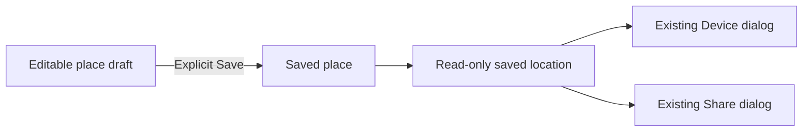

# Task-first Web place editing

## Goal

Make the Web Place workflow clear and usable: edit a draft, save it explicitly, and identify the saved location used by Device and Share. Keep existing capabilities, URLs, command payloads, and confirmation behavior.

## Scope

- Refine the Web Map Place inspector and its existing saved-content actions.
- Preserve the existing Library layout while improving item link names for assistive technology.
- Keep Android, Backend, route editing, authentication, storage, and remote-control permissions unchanged.
- Build on PR #368 with a separate branch and pull request. Do not merge or modify that pull request.

## Review Findings

1. **High — Dirty Place actions overflow.** At 1440×900 in light mode, editing coordinates adds the unsaved-state label and Discard action to a non-wrapping footer. The Save action and status text become clipped. Evidence: `PlaceEditor.tsx` footer and `globals.css` Place action flex rules; browser capture `before-map-place-dirty.png`.
2. **High — Device does not identify its saved source.** The map and fields display draft coordinates, while `PlaceRemoteControlAction` sends `selectedPlace` coordinates. Its dialog has no Place source preview. Device and Share must explicitly identify the saved location without changing what they send or share.
3. **Medium — The Place inspector repeats information.** Its header repeats the saved name, instructions, and coordinates above the editable name and coordinates. The empty inspector also shows editing instructions and a coordinate summary without a selected item.
4. **Medium — Library links hide visible distinctions.** `aria-label="Open {name} on map"` replaces the visible type and location/route details. A Chrome accessibility-tree check found three identical link names for two Places and one Route with the same display name.
5. **Low — New and Save compete for emphasis.** The existing New place and Save place actions use the same solid accent. Keep New available as a secondary action and make saving the selected draft the clear completion action.

## Design Proposal

Generated with `codex-imagegen` after the code and Chrome review. Reference: `/tmp/kestrel-uiux.CAQLP2/proposed-place-workspace.png`. Before captures are in the same directory. All image binaries stay outside the repository and pull request.

Implement the proposal's information hierarchy, not its generated logo, map artwork, or invented component details:

- Keep the existing header, Map/Library navigation, MapLibre map, item picker, and panel controls.
- Use a compact **Place details** heading. Show the editable name only once, followed by the coordinate fields and existing map-editing help.
- Keep More details as the existing disclosure.
- Group existing Device and Share controls under **Saved place**, with the saved name and coordinates. When dirty, explain that these actions still use the saved location and that Save updates it.
- Put draft status and Discard above one full-width primary Save action. Keep the footer inside the inspector width and visible without horizontal scrolling.
- Keep the existing Device dialog; add a saved Place name/coordinate preview before its command action. Do not add a confirmation step.
- Show a short save-first explanation for a new Place instead of unavailable Device/Share controls.
- Use Radix Themes, Colors, and Icons only. Keep existing theme tokens, font, and map marker positioning.

## Plan

- [x] Review current Web Map and Library code and capture the live UI with isolated in-memory API fixtures at 1440×900 in light mode. Generate a proposed design with `codex-imagegen` and retain images outside Git.
- [x] Implement the Place hierarchy, secondary saved-content section, non-overflowing Save footer, and saved Place device preview. Preserve saved-versus-draft payload semantics and existing dialog focus behavior; add focused regression tests.
- [x] Give Library item links accessible names that retain visible type and distinguishing details without changing their stable-ID URLs or adding controls. Verify duplicate display names in the Chrome accessibility tree.
- [x] Translate the new Place and preview messages in all 18 Web catalogs. Run catalog and message tests; do not add an English-only fallback.
- [x] Run Web formatting, lint, tests, typecheck, production build, public-document checks, and cross-platform catalog validation. Keep all required gates intact.
- [x] Verify the implemented UI in native Chrome DevTools: clean, dirty, new, empty, save failure/retry, discard, saved-source Device/Share dialogs, keyboard focus, draft navigation guard, Library search/type/sort, and unchanged Route workflow. Use only the existing 1440×900 light-mode presentation target.
- [ ] Review the complete diff, commit only intended text files, push the new branch, and open a separate pull request with design rationale, check evidence, and external verification limits.

## Completion Checklist

- [x] Save, Discard, and draft status fit inside the dirty Place inspector; no action is clipped or horizontally scrolled.
- [x] Editable coordinates appear once. Empty/new states do not imply that saved content exists.
- [x] Device and Share visibly identify their saved source; dirty edits do not silently become a device command or a public link.
- [x] The Device preview shows the same saved point used by its unchanged command payload.
- [x] Library links with duplicate names expose their visible type and details to assistive technology.
- [x] All 18 catalogs and affected Web checks pass; browser evidence is recorded and no image binary is staged.
- [ ] A separate PR contains only this UI change and its plan/tests, with its dependency on #368 clear.

## Validation Evidence

- Web: `just web-check`, `just web-lint`, `just web-test` (209 tests), `just web-typecheck`, and `just web-build` passed with Node.js 22. This includes 11 new regression tests for saved snapshots, footer constraints, long names, hover styling, and accessible Library links. Biome reports 43 CSS-specificity warnings and no errors.
- Documentation and localization: the public-document check and 10 generator tests passed through `web-check`; `just i18n-check` passed its 16 tests and all 18 Android/Web catalogs. All six new messages exist in every Web catalog.
- Native Chrome 156 DevTools Protocol on the production Web build: 16 Place workflow checks and 11 Library/Route/empty/long-name checks passed at 1440×900 in light mode. A separate hover check passed with 13.71:1 text contrast. No Playwright, additional presentation matrix, real Backend writes, or physical-device operations were used.
- Dirty inspector geometry: the 350px panel contains a 312px completion footer; Save and status text fit, and the collapsed-details body has zero vertical overflow. Device/Share preserve their saved source, save failure preserves retry/discard, and successful Save updates the source explicitly.
- Chrome accessibility names distinguish two Places and one Route with the same name. Existing Library search/filter/sort, stable-ID URLs, Route tabs, saved-route preview, and MapLibre absolute marker positioning passed regression checks.
- The generated proposal, before/after captures, fixture scripts, and check results remain in `/tmp/kestrel-uiux.CAQLP2/`. Key after captures: `after-map-place-dirty.png`, `after-saved-place-device.png`, `after-saved-place-share.png`, `after-new-place.png`, `after-empty-place.png`, and `after-device-long-name.png`.
- Final review added bounded wrapping for long saved names in the existing Device dialog; the 128-character fixture and source regression test pass. Git whitespace checks pass. The existing root `PLAN.md` remains untouched.

## Risks

- Moving secondary actions must not add clicks, submit the Place form, reset drafts, or change when saved data is used.
- Place-specific CSS must not alter MapLibre marker positioning, shared controls, Route layout, or Account styling. Edit existing relevant styles; do not add another global override sheet.
- Browser fixtures verify client behavior and layout only. They do not prove production authentication, persistence, or physical Android delivery.

## External Handoff

The product owner can review the generated proposal and before/after captures outside Git. This is subjective design acceptance, not an unverified implementation check. A device owner must explicitly approve any connected instrumentation or real remote-control smoke test; none is authorized here. Do not claim physical-device delivery, production end-to-end verification, deployment, or release readiness from local fixture checks.
