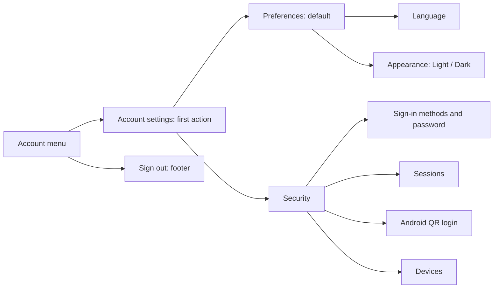

# Web Account Settings Plan

Status: Complete. Implementation and local validation passed on `narumi/feat/web-account-settings`, based on `origin/main` at `9723bcc`.

## Goal

Rename the top-right account menu entry from 帳號安全性 (Account security) to 帳號設定 (Account settings), make it the first action, and organize `/dashboard/account` into a left navigation and a right content panel.

The user approved implementation, a focused branch, and pull request delivery after this plan was drafted.

## Context

- `web/components/WorkspaceHeader.tsx` currently places the appearance toggle before the account security link.
- `web/app/dashboard/account/page.tsx` contains a standalone language selector, section links, sign-in methods, password changes, sessions, Android QR login, and devices.
- `web/components/LanguageSelector.tsx` already saves the language preference and refreshes translated content.
- `web/components/ThemeProvider.tsx` already supports light and dark modes, browser-local storage, and the system theme when no explicit preference exists.
- `web/app/account-ui.css` contains account menu and password styles. Account layout rules also exist in `web/app/globals.css`.
- The supplied reference image defines the layout direction, not a requirement to add its profile, API token, or color palette features.

## Scope

### Account menu

- Keep the existing username heading.
- Place Account settings first among menu actions. Use the visible label 帳號設定 for Traditional Chinese and a Radix settings icon.
- Move the appearance control into Account settings → Preferences. Remove the duplicate appearance action from the menu.
- Keep Sign out in the separate footer and retain its confirmation flow.
- Keep `/dashboard/account` as the settings route.

### Settings page

- Show Account settings as the page title and retain a clear return link to the workspace.
- Use a narrow left navigation and a wider right content panel.
- Provide only two categories: 偏好 (Preferences) and 安全性 (Security).
- Open Preferences by default. Show one category at a time and mark the selected category clearly.
- Preferences contains Language followed by Appearance, with a divider between settings groups.
  - Reuse the existing language list, persistence, pending state, and failure message.
  - Provide explicit Light and Dark choices through the existing theme provider. Keep the existing storage key and saved preferences.
  - State that appearance is saved in this browser. Do not imply cloud synchronization.
  - Preserve system-theme behavior when there is no saved appearance preference. Do not add a new System control in this change.
- Security contains all existing sign-in, password, session, Android QR login, and device functions.
  - Preserve conditional availability, loading states, errors, confirmations, and password focus restoration.
  - Keep dangerous actions inside their existing contextual sections.
- Use Radix components, colors, and icons. Retain the existing Kestrel visual style rather than copying the reference branding.

## Non-Goals

- No Android or Backend changes, database migration, new API, or authentication policy change.
- No profile editor, username change, API token management, color palette selector, or placeholder categories.
- No new theme storage format or cross-device preference synchronization.
- No production operation, merge, deployment, package publication, version tag, or release workflow.

## Plan

### 1. Define navigation and state behavior

- [x] Define `#preferences` and `#security` as category targets. Direct entry without a target opens Preferences; browser Back and Forward restore the category.
- [x] Preserve existing `#sign-in-heading`, `#sessions-heading`, and `#devices-heading` links by opening Security before scrolling to their targets. Unknown targets fall back to Preferences.
- [x] Keep a selected category through a language refresh. An OIDC return with `?oidc=linked` opens Security and shows the existing success notice before removing only that query parameter.
- [x] Define category changes during pending operations. Do not discard an unsaved password form, lose a pending confirmation, reset an in-flight request, or restart a QR login attempt through incidental unmounting. Verify existing QR cleanup behavior before selecting a mount strategy.

### 2. Update the account menu

- [x] Rename the menu entry to Account settings and place it before all other actions. Replace the security-specific icon with a Radix settings icon.
- [x] Remove the menu appearance toggle and its unused imports. Preserve the username heading, settings destination, and confirmed logout behavior.

### 3. Build the settings layout and Preferences panel

- [x] Replace the current top section navigation with the left category navigation and right panel. Use accessible navigation links, a visible current state, and logical heading order.
- [x] Move `LanguageSelector` into Preferences without changing the login or shared-page selectors.
- [x] Add the Appearance group with labeled Light and Dark choices. Reuse theme persistence and handle hydration and unavailable browser storage without breaking the page.
- [x] Keep Preferences usable when security data is loading or fails. Place security feedback in the Security category, with a visible error indicator in its navigation item when required.
- [x] Update account-specific styles without changing unrelated workspace or map styles. Keep narrow-window content usable, but do not add a separate viewport validation matrix.

### 4. Retain the Security workflow and translations

- [x] Place the existing security content under Security without changing endpoints, request bodies, session identity, revocation rules, or authorization checks. Keep existing data loading unless a small change is required to prevent a regression.
- [x] Preserve password expansion, focus restoration, OIDC linking and return handling, QR availability and cleanup, session expansion, device states, and all confirmation dialogs.
- [x] Update the menu label, page title, page description, category labels, loading text, navigation labels, and return text that describe the whole settings page. Keep security-specific messages accurate.
- [x] Add or update strings in all 18 `web/messages/*.json` catalogs. Keep ICU syntax and message-key coverage valid. Use 帳號設定, 偏好, 安全性, 語言, and 外觀 for the corresponding Traditional Chinese labels.

### 5. Verify behavior and presentation

- [x] Add focused regression tests for category target resolution, legacy section links, OIDC return selection, and any new theme selection logic. Use existing Node test conventions; do not add a test framework.
- [x] Run Web gates: `just web-check`, `just web-lint`, then `cd web && npm run test`, `npm run typecheck`, and `npm run build`. Run each command separately and keep each execution within 180 seconds. Split longer checks into observable steps. If dependencies are absent or the lockfile changes, run `npm ci` first.
- [x] Use Chrome DevTools at 1440×900 in light mode to verify menu order, default Preferences, language and appearance controls, Security navigation, direct links, Back/Forward, feedback, and keyboard focus. Save screenshots outside the repository.
- [x] Use an isolated local test account for state-changing checks. Verify language persistence and a Light → Dark → Light round trip without adding a separate dark-mode screenshot matrix. Do not revoke sessions or devices, change passwords, link an identity provider, or complete Android QR login against a real account or device without explicit approval.

## Verification Evidence

- Node.js 22.23.2; lockfile dependencies installed with `npm ci` (no lockfile changes).
- `just web-check` and `just web-lint`: pass. Existing diagnostics remain: 44 CSS specificity warnings and one Biome schema-version notice; no new diagnostics in changed files.
- `cd web && npm run test`: 185 tests passed, including four account navigation tests and seven theme preference tests.
- `cd web && npm run typecheck` and `npm run build`: pass.
- `just i18n-check`: 16 validator tests passed; all 18 Android and Web catalogs passed key, argument, and ICU checks. The existing identical-to-English review report remains (387 entries); no new settings strings appear in that report.
- Chrome DevTools MCP used an isolated headless Chrome profile at 1440×900 in light mode. A separate local Next.js server used an in-memory API fixture, not the running application Backend or a database.
  - Verified menu order, first-action focus, same-route menu dismissal, left/right layout, keyboard category activation, Back/Forward, all three legacy security links, unknown targets, and OIDC success selection/query cleanup.
  - Verified Light → Dark → Light, stored preferences, system fallback before a choice, explicit activation of the current theme by mouse and Space, and blocked theme storage.
  - Verified language transport failure, English ↔ Traditional Chinese switching, reload persistence, fragment restoration after Server Actions, and retention of hidden password drafts.
  - Verified Preferences during delayed/failed security loading, the navigation error indicator, safe error messages, recovery, session expansion, password focus restoration, pending dialogs during history changes, and QR creation/polling without recreation during category changes.
  - Verified a delayed simulated password save while Preferences was active; completion retained the notice and deferred focus restoration until Security became visible.
  - Verified logout and OIDC confirmation dialogs by opening and cancelling them. No real credentials, account revocations, password changes, OIDC linking, QR approvals, or physical-device operations were performed.
- Screenshots remain outside Git: `/tmp/kestrel-account-settings-preferences-zh.png`, `/tmp/kestrel-account-settings-menu-zh.png`, `/tmp/kestrel-account-settings-security.png`, and `/tmp/kestrel-account-settings-security-error.png`.
- Full diff reviewed for correctness, security, lifecycle, compatibility, regressions, and scope. Read-only review found one current-theme activation defect; it was fixed and verified with mouse and Space. Final review found no blockers. `git diff --check` passed; no generated caches, lockfile changes, or binary assets are included.
- Live identity-provider redirects and physical Android QR completion remain untested by design; those existing handlers and API contracts are unchanged. Android source and Backend code are unchanged.

## Completion Checklist

- [x] The first account menu action is Account settings; Traditional Chinese shows 帳號設定.
- [x] Preferences and Security appear in a left navigation; the selected category appears in the right panel.
- [x] Language and Appearance exist only in Preferences within the signed-in settings workflow; saved preferences remain compatible.
- [x] Existing security functions, deep links, OIDC return behavior, and pending-operation state remain intact.
- [x] All 18 message catalogs are complete and valid; relevant tests, formatting, lint, type checks, and build pass.
- [x] Chrome DevTools verification is recorded with no in-repository screenshots or unapproved real-account/device operations.
- [x] Review the final diff for unrelated files and generated cache changes. Update this plan with evidence and move it to `docs/plans/archived/` only after every required check passes.
