# Route Assistant

Status: Completed and locally verified on `narumi/feat/screenshot-route-assistant`, based on `origin/main` at `dd5a509`. The user authorized implementation, verification, commit, push, and pull request delivery. External signup, live inference, database application, deployment, and device actions remain excluded.

## Goal

Let a user describe a route change, explicitly attach the current map screenshot, and review an approximate visual path in the existing Map editor before Apply. Use only that screenshot to judge where a new or changed path goes. Convert image positions to coordinates with deterministic code bound to the captured view, not coordinates invented by a model. Keep manual Save and existing Undo/Redo, Share, sync, and device playback workflows.

This is the single active plan replacing [Route assistant drafts](2026-10-22_route-assistant-drafts-plan.md) and [Road route planning](2026-10-22_road-route-planning-plan.md). Those files remain superseded source snapshots, not completed implementations or separate task trackers.

## Screenshot-only Scope Decision

- The user explicitly replaced external search and road routing with screenshot-only path interpretation. Remove service selection, service integration, geocoding, verified road-following, travel-profile support, and road-network loop guarantees from this plan. These requirements are withdrawn by the scope change, not completed or moved to another plan.
- Every assistant run requires one user-confirmed screenshot and an image-capable chat model. Removing the screenshot prevents submission; it does not enable a text-only fallback. Existing manual editing remains available without AI.
- The request supplies intent. The screenshot supplies visual path evidence. Capture metadata supplies only coordinate conversion, identity, and validation. Existing draft data supplies only retained waypoint identity and metadata; none of these is an alternative road or destination source.
- Do not use geocoding, routing APIs, road graphs, arbitrary web search, model geographic memory, or hidden map-source queries to determine a path. Do not query the user's Places or device position. Normal map rendering remains unchanged.
- Allow approximate tracing of visible paths, visible start/end/via references, and approximate-distance loops within the captured area. If the image is unclear, a name is ambiguous, or the requested path extends outside the image, ask the user to identify the visible target or manually adjust the map and recapture. Do not infer unseen connections.
- Label every result as an approximate visual path, not a verified road route or navigation instruction. A screenshot cannot establish legal access, connectivity at crossings, travel direction, live conditions, or safety.

## Dependencies and Context

- Depends on the independently completed [Personal AI provider settings](2026-10-22_personal-ai-provider-settings-plan.md) for account-backed provider/model/thinking settings and isolated credentials. Keep the full registry and authentication methods. Do not restore provider approval or live-verification activation gates, substitute fixture settings for the requesting user's configuration, or use shared credentials.
- The current AI catalog exposes operation type and thinking levels, not image-input capability. Check the pinned registry/SDK and add only the required capability metadata. Image-generation and classifier operations are not image-capable chat models.
- `web/app/dashboard/map/page.tsx` owns the draft, selection, save lifecycle, and navigation protection. `RouteEditor.tsx` exposes View / Edit / Playback. `routeDraftState.ts` provides `replaceRoutePath` and path-only Undo/Redo.
- `RouteMapEditor.tsx` renders direct waypoint segments on one MapLibre instance. Its canvas omits DOM marker buttons and attribution. Capture must compose those elements explicitly, including marker offsets and leaders that distinguish labels from geographic anchors.
- Current desktop CSS uses approximately 260px for the picker and 350px for the inspector. Use the existing inspector, not another pane or map.
- Current styles are raster maps. The style named `terrain` is an OSM color treatment, not a terrain-elevation model. Establish and test a flat Mercator capture contract instead of assuming every camera/projection can be inverted by the same formula.
- Saved routes require 2–1000 ordered points. Reducers can hold invalid intermediate drafts, so proposals require independent validation. Persisted waypoints contain coordinates and optional speed/pause, not visual anchors or source provenance. Android playback and cloud sync consume this ordered path.
- AI costs remain user-owned. There is no routing/search supplier, credential, billing account, dataset, or service-selection approval to acquire for this scope. Map-source export and AI-transfer terms still apply.

## Implementation Contracts

- Runtime: Node.js 22.23.4; `@earendil-works/pi-ai` and `@earendil-works/pi-agent-core` pinned to 1.4.0. Chat capability uses registry `input.includes('image')`. Inference runs in a bounded worker with a cleared environment and fixed SDK safeguards with resolved user credentials; no ambient key/endpoint fallback.
- Capture: one PNG; each output side ≤1600 px; ≤2,560,000 pixels; ≤2 MiB encoded PNG bytes; ≤2,796,204 base64 characters; ≤4 MiB request body. RGB/RGBA 8-bit non-interlaced PNG only; at most 1024 chunks. Decode allocation is bounded by the validated pixel/scanline size (≤10,241,600 bytes). Capture wait ≤5 s; submission age ≤120 s; review image lifetime ≤10 min.
- Conversion: zero-pitch flat Mercator only; independent samples must round-trip within 0.25 output pixels. Image positions use the map-content rectangle, excluding the 40 px attribution footer. Keep full coordinate precision; no geometry reduction. Resolve longitude against the frozen view center, including wide and rotated views. Reject repeated worlds and require intermediate visible points for legs spanning half a longitude world.
- Runs: ≤90 s, 4 model turns, 16,384 total output tokens, 8 tool calls, and 3 candidate attempts. No automatic SDK retries (`maxRetries: 0`) or application replay. One active run per user, at most 4 active runs and 256 recent run IDs per Backend process; at most 4 starts/minute/user. Production Compose runs one Backend process; multi-replica coordination is not implemented. Final-payload caps include SDK thinking-budget expansion; Bedrock retry/profile/endpoint controls and explicit Vertex-key checks prevent ambient authentication.
- Geometry: 2–1000 final points; new points receive null speed/pause. Loop targets 0.1–20 km; stored-path length within ±10%; closure within 10 m; 3 candidates maximum. All GeoJSON route sources use zero simplification tolerance.
- Source disposition: OSM-based capture is supported with image and application attribution; Esri capture is disabled pending source-owner permission. [Official evidence and retained attribution](../../route-assistant-source-terms.md) resolve the OSM-only scope without a route-schema change. Web route editing/preview maps retain OSM credit across base-style changes; Android already retains native OSM attribution.
- Verification uses deterministic tiles, fake provider calls, and transient test state, not live AI accounts or a database. Public source terms were read; no supplier account or paid request was created.

## Architecture

```mermaid
flowchart LR
    UI["Existing Map editor: request"] --> Capture["Explicit screenshot capture and review"]
    Capture --> API["Authenticated bounded run: frozen snapshot"]
    API --> Agent["pi-agent-core and pi-ai: user image-capable chat model"]
    Agent --> Trace["Bounded image positions and retained point references"]
    Trace --> Convert["Deterministic captured-view coordinate conversion"]
    Convert --> Validate["Validate complete approximate path and metadata"]
    Validate --> Preview["Candidate layer on existing MapLibre map"]
    Preview --> Apply["Explicit Apply: one path-history step"]
    Apply --> Draft["Existing draft"]
    Draft --> Save["Existing manual Save and sync"]
```

### UI and state ownership

- Add one AI route assistant entry beside the existing Edit path tools. Reveal the request, screenshot, current provider/model/thinking, status, and proposal inside the current inspector. Do not add a workspace, map, New route action, Save button, or required editing mode switch.
- Keep one inspector scroll owner. Use Radix components and current message catalogs, not a generic chat UI library. Keep keyboard focus and existing Edit tools usable.
- Missing credentials or image-input capability must show a clear next step and a guarded settings link. Do not navigate away, discard the draft, switch models, or submit without the user's choice. Removing an image returns to the capture-required state; manual editing remains available.
- Modify path geometry only. Name, description, visibility, playback mode, and speed remain under existing controls because Undo is path-only.
- Keep conversation, proposals, image buffers, and conversion metadata only for the active editor session, with finite memory, message, image, point, output, and lifetime limits. Reload/restart does not promise chat recovery or offline draft persistence.

### Required map screenshot

- Attach exactly one PNG per run, only after the user chooses capture. Show the exact image, capture context, provider/model, and position/cost/retention disclosure before submission. No automatic capture, background refresh, automatic submission, or agent-controlled camera/capture tools.
- Capture only the existing map canvas and explicitly compose the selected route's visible markers/labels/leaders and license-required attribution. Exclude Account UI, inspector text, unrelated private overlays, popups, and device information. Do not capture the whole page, arbitrary DOM, or another map instance.
- Capture a fully rendered frame within a bounded wait. Verify WebGL buffer handling and the performance impact of any preservation setting. Missing tiles, loading/error maps, blank output, cross-origin export restrictions, and an unavailable map are visible failures, not valid attachments.
- Bind the capture ID/time to authenticated user/session, editor instance, route identity, monotonically increasing draft generation, settings/connection generation, and client run ID. Include ordered draft IDs/coordinates/events, bounds, center, zoom, bearing, pitch, projection, style/source attribution, canvas CSS/backing dimensions, output dimensions, map-content rectangle, pixel scale, and frozen conversion data from the same frame.
- Keep full draft coordinates and conversion data within the authenticated application boundary. Send the provider only the confirmed image, bounded user request, image dimensions, and visible marker references needed for the task. Do not send off-screen draft content, Places, library contents, device data, or earlier screenshots as extra geographic context.
- Treat image content and metadata as untrusted. Set numeric dimension, pixel, encoded/decoded-byte, body-size, capture-wait, capture-age, and lifetime limits during discovery. Enforce them on both sides before allocation/decoding and provider calls. Validate PNG signature/header/decoded dimensions, bounded decoding, and metadata consistency; client metadata never authorizes access or provider selection.
- Camera, size, style, or draft changes during capture or before submission discard the attachment and require explicit recapture. After submission the snapshot and conversion remain fixed: later panning must not replace the image or invalidate an otherwise unchanged draft. Never interpret pixels against a newer camera.
- A missing image or incompatible selected model prevents inference. Offer explicit recapture, a guarded settings change, or continued manual editing. Do not send a text-only request, substitute another model, or treat an image-generation operation as image understanding.
- Disclose precise-position exposure, possible image charges, and provider retention separately from local transient storage. Do not log or persist images, base64, prompts, conversion payloads, or geometry in assistant history/telemetry. Approved geometry is persisted only by the existing manual Save workflow.
- Release buffers/object URLs after removal, invalidation, cancellation, expiry, Apply/discard, or session end. Keep only the bounded current review image while needed; never silently reuse an image in a later run.
- Record actual map-source export, derived-path, AI-transfer, attribution, and retention terms before enabling capture for that source. Successful canvas export does not establish permission. Prepare public evidence and identify any owner-only permission action without adding AI-provider approval gates. Resolve any required stored attribution before coding its persistence; do not assume the current schema is sufficient.

### Screenshot interpretation and coordinate conversion

- Each model path entry is either an unchanged existing waypoint reference or a normalized image position, optionally bound to one visible waypoint reference for an explicit move. Resolve references only against the captured draft. The model must not submit arbitrary latitude/longitude, external destination IDs, network endpoints, or claims of verified roads.
- Normalize positions against the captured map-content rectangle, not the full PNG: its top-left is `(0, 0)` and bottom-right is `(1, 1)`, with both bounds inclusive. Convert to continuous output-image positions as `x = left + u * width`, `y = top + v * height`. Record PNG scaling, CSS pixels, device pixel ratio, and attribution margins. Reject non-finite/out-of-range positions and any reference into attribution/UI margins.
- Support flat Mercator captures with zero pitch and no elevated terrain. Preserve supported bearing through the captured transform. Reject unsupported projection, pitch, repeated-world ambiguity, or non-invertible capture geometry with a request for a manual view adjustment; do not silently reset the camera or approximate an unsupported transform.
- Freeze a pixel-to-Mercator affine transform from the captured view using public MapLibre projection/unprojection APIs and sufficient independent reference samples to verify it. Perform image-position-to-coordinate conversion deterministically from that snapshot. Do not call `unproject` on the later live viewport, use private mutable MapLibre state, or instantiate a second map.
- Before implementation, record numeric pixel round-trip and coordinate-conversion tolerances from deterministic fixtures. Test center/edge positions, rotation, latitude/zoom variation, output resizing, pixel scale, date-line wrapping, and unsupported views. Conversion precision is not evidence of road accuracy.
- Visible labels can identify user intent but cannot verify destination identity. Resolve duplicate or unclear labels by asking the user to identify the visible location and submit a fresh confirmed screenshot. Do not silently choose a label or look up coordinates from memory.
- Limit new and moved points to the captured area. Existing off-screen points may remain unchanged by reference; they are not evidence for new off-screen geometry. Preserve explicit start/end/via anchors and reject a candidate whose requested visible anchor cannot be mapped consistently.
- If a visible line could be a bridge, tunnel, barrier, disconnected crossing, or obscured path, report uncertainty and ask for clarification rather than invent a connection. These checks do not establish real-world connectivity or safety.

### Agent and transport boundary

- Run `pi-agent-core` and `pi-ai` in Backend. Expose only bounded snapshot inspection, visible marker references, deterministic path operations/conversion, stored-path distance measurement, and proposal submission. No coding-agent session, shell, filesystem, arbitrary HTTP, dynamic code, browser/remote-control tools, geocoding, or routing tools.
- Resolve provider/model/thinking and credentials from the requesting user's saved settings. Derive ownership from authentication; validate client IDs, settings/connection generations, and schemas on every control path. The model cannot select a provider, authorize a write, or access another user's run/proposal.
- Use deterministic code for retaining, reversing, inserting, removing, reordering, or closing the proposed path. These operations cannot invent an unseen connecting segment or change non-path fields. Screenshot interpretation remains approximate even when transforms are deterministic.
- Treat prompts, image labels, model messages, and tool arguments as untrusted data. Test prompt-injection attempts in visible labels and malformed tool calls. Return only bounded safe text, tool-status labels, validated proposals, and completion/errors; never raw thinking, credentials, tool-argument dumps, images, or raw provider errors.
- Use an authenticated fetch stream. Verify bounded upload, streaming, and abort through `web/app/api/backend/[...path]/route.ts` and the deployed proxy configuration. Do not put credentials in an EventSource URL or automatically replay an ambiguous paid request.

### Geometry, distance, and compatibility

- Convert accepted image positions to finite, in-range Kestrel latitude/longitude fields. Use explicit longitude/latitude order only at GeoJSON rendering boundaries. Validate full ordering, image bounds, anchor association, duplicate IDs, waypoint events, and total response size before preview and Apply.
- Unchanged waypoint references retain exact IDs, coordinates, and speed/pause. An explicit image-position move preserves the referenced visible waypoint's ID and speed/pause at its deterministically converted position. Reject duplicate references, off-screen moves, and unsafe event/anchor mapping instead of silently moving, copying, or dropping an event. New points use existing null defaults. Require explicit confirmation before a proposal removes an event-bearing waypoint.
- Accept 2–1000 final waypoints. Require the model to stay within this budget and reject excessive output with a request for a shorter/simpler path. Do not silently truncate, automatically simplify away visual bends/events, or expand the cross-platform limit.
- Use one validated final geometry for preview, displayed distance, Apply, Save, revision mapping, sync, and Android playback. Display distance computed from the stored direct-segment path, never a road-service distance or model estimate. A visually plausible trace can still cut corners between points.
- Support approximate-distance loops only when the complete new loop is visible in the screenshot. Publish a numeric target-distance range, closure tolerance, distance tolerance, candidate-attempt budget, and run budget during discovery. Measure each candidate deterministically; accept only within those limits. If no candidate fits, return failure/clarification, not a fabricated success or a road-network guarantee.
- Show capture source/attribution, point count, measured path distance, any loop target/error, and visual-uncertainty warnings. Keep required attribution after Apply/Save where source terms require it. No verified travel profile, road snapping, road coverage, or navigation claim is available.
- Manual waypoint edits keep current direct-segment semantics. Do not imply that manual edits preserve a visually traced path's fit to roads. Review existing JSON/revision/sync/Android contracts before coding; make no schema change by assumption.

### Proposal and lifecycle contract

- Bind each image, tool result, and proposal to user/session, editor instance, route identity, draft generation, run ID, settings/connection generation, and capture ID. A new route has an identity distinct from a saved route.
- Use a generation counter, not coordinate equality: edit → undo cannot revive an obsolete result. Validate complete candidates; partial streamed JSON never changes the draft or becomes applicable.
- Render a completed candidate in a separate source/layer on the existing MapLibre instance. Label current and approximate candidate paths distinctly. Clear the candidate on invalidation or discard, and use only explicit fit requests.
- Apply once with a functional draft update and `replaceRoutePath`. Repeated clicks are a no-op. Preserve non-path fields, clear the consumed proposal/image, and issue the existing explicit fit request.
- Manual edits, route switches, new-route replacement, discard, settings/credential changes, logout, timeout, and cancellation invalidate affected captures/runs/proposals. Ignore late events and require a fresh capture/run rather than silent rebase. Post-submission camera-only changes follow the fixed-snapshot rule above.
- Disable Apply during an in-flight Save. A successful Save that changes the baseline must advance the bound draft generation even if coordinates do not change, abort active runs, and invalidate all captures and proposals. Check that generation at delayed completion and Apply so a pre-Save run cannot become current afterward. Failed Save retains the draft and cannot revive previously invalidated results. Existing revision snapshots do not provide cross-tab compare-and-swap protection.
- Bound run duration, turns, tokens, tools, candidate attempts, images, per-user concurrency, and total memory. Reject duplicate active client run IDs. Propagate cancellation to capture work, provider calls, and tools. Stream loss is not upstream cancellation evidence; do not claim exactly-once billing.

## Non-Goals

- No external search/routing integration, service-selection gate, road dataset, road-graph verification, travel profiles, authoritative geocoding, or model-invented geographic coordinates.
- No second map renderer, whole-page screenshot library, arbitrary browser tools, autonomous viewport exploration, automatic recapture, image-free assistant fallback, or inferred off-screen path.
- No GPX/KML, route recording, turn-by-turn navigation, live traffic, offline road-data delivery, automatic Save/device playback, or claims of route safety/legal access.
- No autonomous writes, agent-triggered Android commands, persistent chat/image history, resumable background jobs, cross-tab route-write concurrency redesign, or unrelated Library/Places search workflow.
- No fabricated distance, cost, connectivity, or success after a failure. Reported usage can be unavailable for subscription flows. No schema expansion without an identified compatibility or source-attribution requirement.

## Plan

Run the phases in dependency order. Use deterministic tiles and fake multimodal providers by default. All retained tasks below are complete and verified against the evidence in this file; the former search/routing tasks were removed by the explicit screenshot-only scope decision, not marked complete.

### Phase 1 — Capture and screenshot contracts

- [x] Confirm provider/credential contracts and compatible `pi-agent-core` loading under Node.js 22. Record pinned/tested versions and prove one bounded image-plus-tool loop with a fake provider. Test text-only and non-chat selections without inference or silent substitution.
- [x] Check pinned registry image-input metadata and add only the capability data needed by the assistant. Acceptance: the selected model must be an image-capable chat model; missing/unsupported selections produce a draft-safe next step, not a provider approval gate.
- [x] Record actual source-specific export, derived-path, AI-transfer, attribution, and retention terms using public evidence. Prepare owner-only permission handoff where needed. Acceptance: supported capture sources have a documented disposition; no unsupported source is silently sent to a provider.
- [x] Prove capture on the existing MapLibre instance with deterministic tiles. Test rendered-frame timing, loading/error/missing tiles, blank output, CORS failures, marker offsets/leaders/labels, attribution, excluded private UI, and WebGL performance. Record numeric capture/transport/lifetime limits before implementation.
- [x] Define typed snapshot/run/event/pixel-proposal contracts and fixed resource limits. Enforce exactly one PNG, bounded decoding, owner/generation/capture binding, and one-frame consistency. Test invalid MIME/signature, malformed PNGs, excessive dimensions/bytes, missing images, invalid references, malformed input, and mismatched metadata/generations.
- [x] Prove deterministic captured-view pixel-to-coordinate conversion for flat Mercator at zero pitch, including supported bearing and output scaling. Record numeric tolerances and test independent samples, normalized boundary values, nonzero attribution margins, edges, latitudes/zooms, date-line wrapping, and rejected unsupported views. Acceptance: later camera changes cannot affect conversion; no second map/private mutable transform is used.

### Phase 2 — Assistant, visual proposals, and editor lifecycle

- [x] Implement user-scoped restricted tools and deterministic visual-path conversion/operations. Test forged waypoint IDs, cross-user run/proposal access, image-label injection, raw model latitude/longitude rejection, and prohibited network/tool requests. Acceptance: only screenshot positions and validated retained references can form a candidate.
- [x] Implement authenticated bounded run creation, event streaming, and explicit cancellation. Verify ownership on every path, duplicate starts, concurrency/rate/memory limits, abort through the Next.js proxy, provider timeout, malformed output, and no automatic paid retry. No geocoding/routing requests are available.
- [x] Add testable generation/proposal state. Cover manual edit, edit → undo, route switch, new-route replacement, discard, Save/baseline generation changes, pre-Save capture/run completion arriving after successful Save, failed Save, settings/credential change, disconnect, logout, timeout, cancellation, late completion, and interleaved runs.
- [x] Build the existing-inspector assistant UI with request, required screenshot, current AI configuration, disclosure, safe progress, Stop, failure recovery, and approximate-path summary. Verify keyboard focus, one scroll owner, existing Edit tools, draft-safe settings navigation, and no request before explicit submission.
- [x] Implement explicit capture/review/removal and in-memory cleanup. Test camera/resize/style/draft races before submission, a fixed submitted snapshot during later panning, image removal, late capture, settings/logout/cancellation/expiry, Apply/discard, and interleaved runs. Acceptance: no automatic refresh, later-run reuse, persistent image/history storage, or sensitive logging.
- [x] Implement bounded screenshot-only path tasks for visible start/end/via references and approximate loops. Set numeric loop tolerances and candidate budgets before coding. Test clear and ambiguous labels, obscured/disconnected-looking crossings, off-screen requests, insufficient detail, missing tiles, acceptable targets, tolerance failure, exhausted budgets, and cancellation. Acceptance: ask for visible clarification/recapture or fail; never invent destinations or claim verified connectivity.
- [x] Validate complete 2–1000-point candidates, unchanged references retaining exact IDs/coordinates/events, explicit visible-point moves retaining IDs/events, generated null defaults, and explicit event-removal confirmation. Test invalid numbers/ranges/order, unknown/duplicate references, off-screen moves, sharp bends, duplicate coordinates, loops, long paths, date-line cases, and 1000-point boundaries. Reject unsafe/excessive geometry rather than truncate or silently simplify.
- [x] Add the distinct candidate layer and exact final-path summary on the existing MapLibre instance. Verify ready/loading/error maps, source attribution, uncertainty label, measured distance, loop target/error, explicit fitting, and invalidation/cleanup without another map.
- [x] Apply a valid proposal as one path-history entry. Test repeated clicks, Undo/Redo, preserved metadata and non-path fields, Apply disabled during Save, failed Save retaining the draft, baseline generation invalidating captures/runs/proposals after successful Save, delayed pre-Save completion remaining unusable, and no route persistence/device command before existing user actions.
- [x] Prove compatibility through save/reload, Backend revision mapping, sync fixtures, and relevant Android JVM playback tests. Preserve sequence, modes, distance behavior, and waypoint events with the same final geometry. Resolve required derived-path attribution storage before enabling the affected source; connected instrumentation still requires separate consent.

### Phase 3 — Documentation and shared verification

- [x] Update `docs/web-cloud-guide.md`, necessary API/operations documentation, and all current Web locale catalogs. Cover account/image-capable-model setup, required capture consent/removal/recapture, source terms, limits, transient history, provider exposure/retention/cost, approximate visual paths, unsupported/off-screen requests, geometric loop tolerances, direct-segment manual edits, Stop/failure, explicit Apply/manual Save, and no search/routing service or verified-road claims.
- [x] Use Chrome DevTools at 1440×900 light mode with deterministic tiles and multimodal fixtures. Verify exact transmitted image/context, marker alignment/leaders, attribution, excluded private UI, required-image submission, unsupported models, blank/CORS failures, limits, capture races, fixed conversion after panning, cancellation, and cleanup. Keep captures outside Git; make no live inference request.
- [x] Use Chrome DevTools at 1440×900 light mode for visual-path preview, ambiguous/off-screen requests, loop success/tolerance failure, provider outage, keyboard use, draft/navigation protection, generation races, Save safety, Apply/Undo, and 2/50/1000-point rendering. Verify no geocoding/routing/extra-context requests and no persistence/device commands from inference or preview. Keep captures outside Git.
- [x] Run `just web-check`, `just web-lint`, Web tests/typecheck/build, `just i18n-check`, Backend lint/unit/e2e/typecheck/build, and `git diff --check` as separate commands, each within 180 seconds. Split longer checks into observable steps. If Android code/contracts change, run narrow affected JVM tests and `just android-test` plus affected Android format/lint/build checks. Schema changes require a reviewable migration and `npm run prisma:generate`; do not apply a database migration without approval.
- [x] Review the complete diff for correctness, security, lifecycle safety, compatibility, regressions, and scope. Record evidence against every retained requirement and prepare external handoff without claiming fixture results prove live provider or physical-device behavior.

## Verification Evidence

All retained implementation and local-verification tasks passed. Source snapshots remain superseded, not falsely completed service integrations. No required approved live test is outstanding; the excluded owner actions below remain unverified.

| Area | Evidence |
| --- | --- |
| Runtime and registry | Node.js 22.23.4; both SDKs pinned to 1.4.0. `npm run test:ai:integration` passed registry/auth isolation, fake image/tool/privacy/injection/budget cases, final payload limits, profile/endpoint/retry controls, and source/compiled workers. Registry: 42 providers; 41 API-key and 9 OAuth methods. No live network inference. |
| Backend | `npm ci`, `npm run prisma:generate`, lint, 493 unit tests, 21 e2e tests, typecheck, build, and SDK integration passed. PNG, malformed-byte, transform/marker, ownership, cancellation, rate/concurrency, timeout, duplicate-run, and bounded-body tests passed. No database migration was applied. |
| Web | `just web-check`, `just web-lint`, 255 tests, typecheck, production build, and `just i18n-check` passed. All 18 catalogs contain the assistant messages. |
| Android | Java 26; narrow geometry/playback/compatibility tests followed by 267 JVM tests in 50 suites. Android format check, Detekt, resource lint, and debug build passed. Route source options explicitly disable simplification. No device operation. |
| Chrome | Local production Next.js build, actual Next-to-Backend stream path, 1440×900 light mode, deterministic tiles, and fake multimodal calls: core 25, lifecycle 16, captures 51, loops 10; **102 checks passed**. WebGL buffer preservation remained off; reviewed captures completed within five seconds. |
| Image and source | Exact reviewed/uploaded PNG hashes, one-image privacy checks, marker anchors/leaders, attribution, plain/terrain/dark styles, blocked satellite export, removal/revocation, blank framebuffer, actual tainted-canvas failure, oversized browser upload, capture camera/resize/style races, and fixed post-submit conversion passed. |
| Geometry and lifecycle | Exact 2/50/1000-point candidate sources; 1000-point Apply/Save equality; wide/rotated/date-line conversion and unseen-short-arc rejection; metadata preservation, removal confirmation, one Apply/Undo, failed Save, invalid assistant input not blocking Save, settings/Save invalidation, cancellation, no replay, loop success/failure, and provider failure passed. |
| Compatibility | Shared `app/src/test/resources/route-assistant-path.json` covers Backend revision/sync mapping and Android ordered rows/playback modes/events. Web production fixtures prove exact final geometry through Apply and manual Save. Route JSON/revision/sync schemas are unchanged. |
| OAuth refresh | A delayed real credential-store modify with interleaved settings polls preserves its generation. Secret-free `refreshing` metadata distinguishes the live lease from terminal reconnect failure. Client lifecycle, replacement/disconnect guards, and Apply checks passed. No credential quarantine or revocation rule was weakened. |
| Review | Independent reviews found and then verified fixes for transient OAuth cancellation and wide-view world selection. Follow-up found no blockers. Final diff and whitespace checks passed; no binary artifacts are included. |

Local browser reports are `/tmp/kestrel-route-assistant-{core,lifecycle,captures,loops}.json`. Review/input/preview PNGs remain outside Git under `/tmp/kestrel-route-*`. Automated logs are also outside the repository. Fixture results do not prove live vision quality, account entitlement, provider billing/retention, deployed edge behavior, or physical-device rendering.

The assistant body remains limited to 4 MiB, with fixed bounded readers at both hops. Route POST/PATCH has a separate 256 KiB cap so full-precision 1000-point paths remain saveable; other Backend bodies retain 100 KiB. The event reader is capped at 512 KiB. Review lifetime is ten minutes **from capture**, not submission. These are application limits, not a container-memory or provider-refund guarantee.

## External Handoff

- Map-source permissions — the source/account owner reviews any source-specific export, derived-path, transfer, attribution, or retention permission that public terms do not resolve. Prerequisite: prepared official evidence and the proposed screenshot/data flow. The owner obtains required permission; until then, do not enable capture for that source or claim its use is approved.
- Live AI/account actions — the account owner authorizes any live inference, login, or permission change after reviewing precise-position/image exposure and possible cost. Use fixtures until authorized. Do not request secrets in chat or restore provider-verification activation gates. Upstream retention/cancellation behavior remains unverified without evidence.
- Physical-device checks — the device owner identifies the target and consents after a state/data-risk disclosure. Prepare JVM/sync fixtures first. Do not claim actual device behavior, data preservation, or connected-instrumentation success without evidence.

No routing/search approval or account setup is required. External handoff does not authorize external writes, paid operations, or removal of failed implementation checks. Any required live acceptance evidence remains open until obtained.

## Risks

- A screenshot does not establish road connectivity, direction, access, elevation, current conditions, or safety. A correctly converted line can cross a barrier or cut a corner. The result is an approximate visual path for user review, not navigation.
- Low zoom, labels, marker offsets, tile gaps, and occlusion can make paths unclear. Refuse unsupported inference instead of inventing unseen geometry. A numeric coordinate-conversion tolerance measures conversion only, not real-world road accuracy.
- Images, prompts, and geometry can expose precise positions. Send only disclosed snapshot context. Exclude images, base64, prompts, bodies, conversion payloads, geometry, secrets, and query strings from logs/telemetry; user-approved route persistence remains under manual Save.
- Canvas export can fail or omit markers/attribution. Camera changes can mix image and coordinates unless capture and conversion are bound to one frame. Map-source export, derived-path, transfer, attribution, and retention terms can differ between OSM and Esri-based styles.
- Distance is the length of Kestrel's final direct-segment path, not proof of actual travel distance. Screenshot-only loops can fail within the fixed budget; report that failure without a road-service fallback.
- Stream loss does not prove upstream cancellation or prevent provider charges. Current route PATCH has no cross-client version precondition; do not claim the assistant solves that limitation.

## Rollback / Recovery

- Stop new assistant runs, abort active work, clear unaccepted candidate layers, and release transient images/conversion data. Preserve current drafts, saved routes, and existing manual editing.
- Missing capture, unsupported models/views, or source-permission failures disable assistant submission, not manual editing. Do not fall back to text-only inference, model-invented coordinates, or external search/routing.
- Keep provider settings/credentials intact unless the user disconnects them. Saved geometry remains usable without an AI call or screenshot; retain any required attribution. Do not delete routes, restore a database, or roll back schema automatically.
- A failed/aborted run leaves the draft unchanged. After Apply, existing Undo restores the prior path. After Save, do not claim automatic revision restore.
- Migration rollback, credential revocation, account cancellation, deployment, production changes, or device actions require separate authorization and reviewed recovery steps.

## Completion Checklist

- [x] Each run requires one explicitly confirmed screenshot and the requesting user's saved image-capable chat provider/model/thinking configuration, with no shared credentials, silent substitution, or text-only fallback.
- [x] Only screenshot-visible content determines new/changed paths. No geocoding/routing service, road graph, model geographic memory, Places lookup, device position, or inferred off-screen connection is used.
- [x] Model output contains only validated image positions and retained waypoint references. Frozen deterministic conversion passes recorded numeric tolerances and cannot use a later camera or arbitrary model coordinates.
- [x] Screenshot, route context, marker positions, camera/projection, dimensions, attribution, and generations describe one frame. Required capture/transport limits, malformed-image, and unsupported-view tests pass; private UI is excluded.
- [x] Images remain transient. Capture races, removal, cancellation, expiry, settings changes, logout, and late events cannot mix contexts, restore removed images, or reuse them in later runs. No automatic capture, persistent chat/image storage, or sensitive logging occurs.
- [x] Source-specific export/derived-path/transfer terms, attribution, provider disclosure, and retention constraints have documented dispositions. Any unresolved required permission blocks only the affected source; it is not reported as approved.
- [x] All candidates are labeled approximate visual paths, not verified roads/navigation. Ambiguous, obscured, insufficient-detail, and off-screen requests produce clarification/recapture or a clear failure without invented location data.
- [x] Visible start/end/via and approximate-loop tasks pass declared success/failure, measured-distance tolerance, closure, and candidate-budget tests. No model-estimated road distance or fabricated success is shown.
- [x] Final paths contain 2–1000 valid ordered points. Unchanged references retain exact IDs/coordinates/events; explicit visible-point moves preserve IDs/events at deterministically converted positions. Generated points use null defaults; event removal requires explicit confirmation. Excessive/unsafe geometry is rejected, not truncated.
- [x] Candidates are previewed separately; only explicit single Apply changes the draft and creates one Undo entry. Stale, duplicated, cancelled, cross-user, and partial results cannot change routes or trigger persistence/device actions.
- [x] Save, Share, playback, navigation, metadata, Save failure retention, and Save/baseline races pass regression checks. Preview, stored revision, sync, and relevant Android JVM playback use the same final geometry/event order.
- [x] Required automated and Chrome checks pass; documentation/locales match screenshot-only behavior. No unapproved paid, database, deployment, or device operation occurred. Required live evidence is recorded or remains explicitly open without a success claim.
- [x] Archive only after every retained task/completion item has valid evidence. Do not close by moving unfinished work elsewhere; the documented user-requested service-scope removal is not evidence of implementation.
